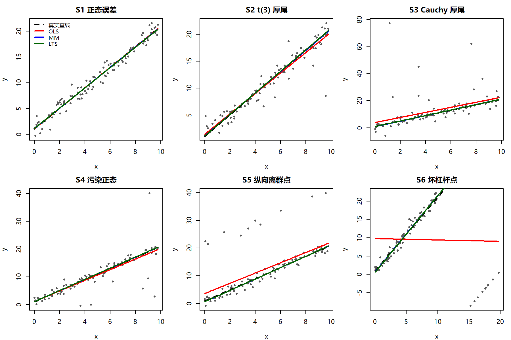
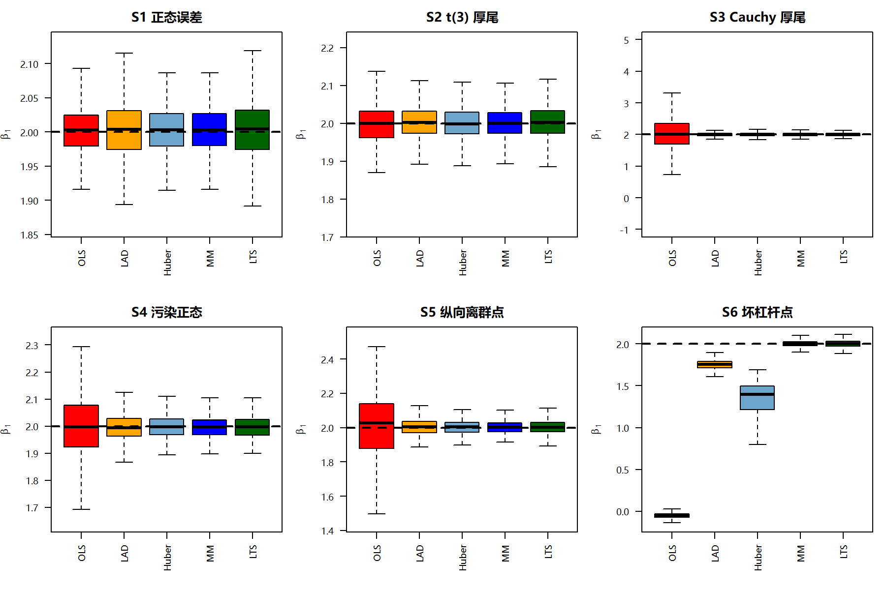
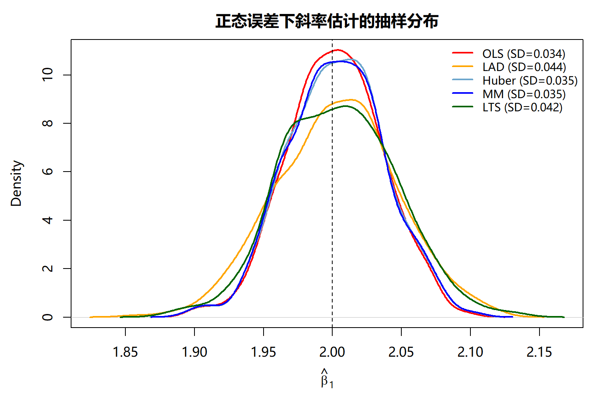
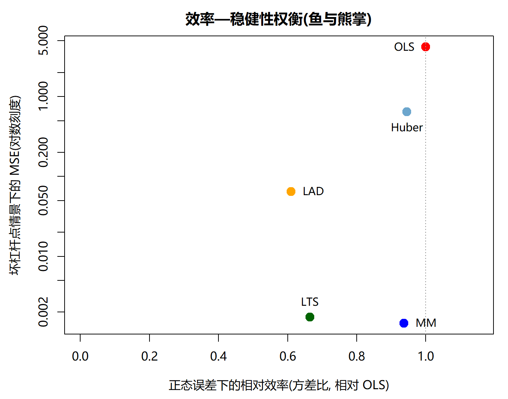
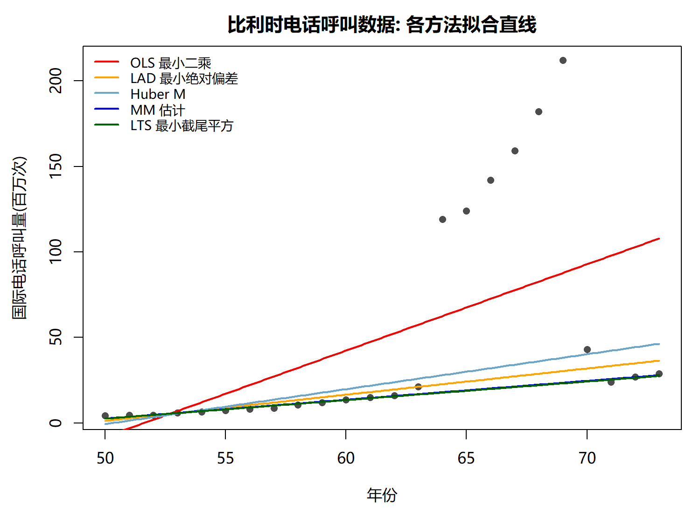
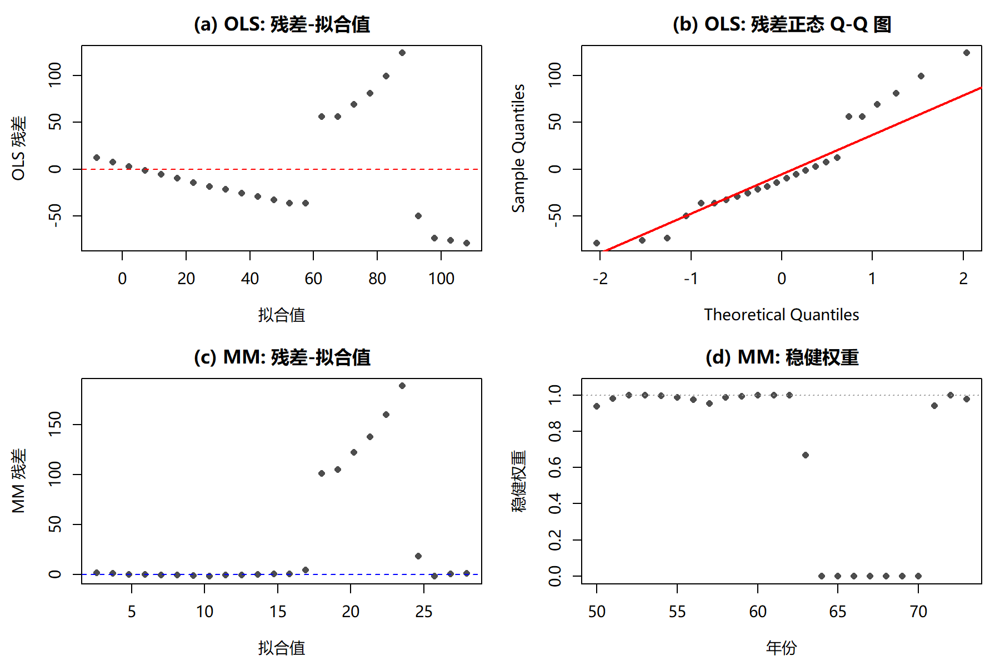
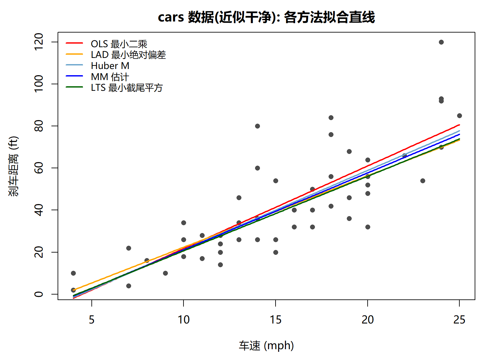
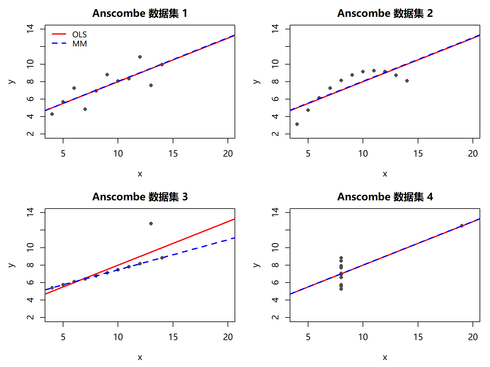

# 一元线性回归中稳健回归方法的比较研究

> Robust Regression for Simple Linear Models: Methodology, Monte Carlo Evidence and Real-Data Analysis


用 **6 种数据污染情景 × 500 次蒙特卡洛模拟**，配合 **3 个真实数据集**，比较一元线性回归中五种估计量的**效率**与**稳健性**，全部结果由仓库内 R 代码一键复现。

核心问题：**当正态性、同方差性或外生性被离群点、厚尾、高杠杆观测破坏时，OLS 会在多大程度上失效？四类稳健方法各自能挽回多少？代价是什么？**

---

## 目录

- [1. 结论速览](#1-结论速览)
- [2. 五种估计方法](#2-五种估计方法)
- [3. 实验设计](#3-实验设计)
- [4. 主要结果](#4-主要结果)
- [5. 复现指南](#5-复现指南)
- [6. 仓库结构](#6-仓库结构)
- [7. 参考文献](#7-参考文献)

---

## 1. 结论速览

| # | 结论 | 证据 |
|---|------|------|
| 1 | 不存在普遍最优的方法，效率与稳健性是**鱼与熊掌** | 图 3 |
| 2 | 正态误差下 OLS 最优，Huber M 与 MM 仅损失约 **6%** 效率 | 表 1、图 4 |
| 3 | Cauchy 厚尾下 OLS 斜率方差被放大到 **20.1**，稳健方法维持在 **0.0027–0.0040** | 表 1（S3） |
| 4 | 仅 **10%** 的污染就足以让 OLS 的 MSE 变成稳健方法的 **5.8–8.9 倍** | 表 1（S4） |
| 5 | **坏杠杆点**下 OLS 斜率偏差达 **−2.051**（真值 2），LAD 与 Huber M 同样崩溃；只有 50% 崩溃点的 MM 与 LTS 几乎无偏 | 表 2 |
| 6 | MM 估计在全部情景中表现均衡，可作实际应用的默认选择 | 图 2、图 3 |

---

## 2. 五种估计方法

模型为 $y_i = \beta_0 + \beta_1 x_i + \varepsilon_i$，共同假设为线性性 A1、外生性 A2、同方差性 A3、无自相关 A4，OLS 在此之上还需要误差正态性。

| 方法 | 目标函数 / 原理 | 特有假设 | 崩溃点 | 正态下 ARE（理论） | R 实现 |
|------|----------------|----------|--------|----------------|--------|
| **OLS** 最小二乘 | $\min \sum (y_i - \beta_0 - \beta_1 x_i)^2$ | A1–A4 + 正态性 | 0 | 1.00 | `stats::lm()` |
| **LAD** 最小绝对偏差 | $\min \sum \lvert y_i - \beta_0 - \beta_1 x_i \rvert$ | 误差条件中位数为 0，不要求对称与有限方差 | 0 | ≈ 0.64 | `quantreg::rq()` |
| **Huber M** | $\min \sum \rho\!\left(\frac{r_i}{\sigma}\right)$，$\psi$ 在 $k=1.345$ 处截断 | 误差关于 0 对称、单峰、尾部不太厚 | 0 | ≈ 0.95 | `MASS::rlm(psi = psi.huber, k = 1.345)` |
| **MM** | 高崩溃点 S 估计作初值 + 高效率 M 步精化 | 几乎不依赖分布形态 | **0.50** | ≈ 0.95 | `robustbase::lmrob()` |
| **LTS** 最小截尾平方 | $\min \sum_{i=1}^{h} r_{(i)}^2$，$h = \lfloor n/2 \rfloor + 1$ | 内点比例至少 50% | **0.50** | ≈ 0.66 | `robustbase::ltsReg(alpha = 0.5, nsamp = 500)` |

**三个稳健性度量**：

- **影响函数 IF**：OLS 的 IF 同时正比于 $(x_0 - \bar x)$ 与残差，在两个方向上均无界；LAD 与 Huber M 只在残差方向有界，因此**无法抵抗高杠杆点**；只有 MM 与 LTS 的 IF 双向有界。
- **崩溃点 BP**：使估计被破坏所需的最小污染比例。OLS / LAD / Huber M 均为 0，MM 与 LTS 达 50% 的理论上界。
- **渐近相对效率 ARE**：正态理想情形下 OLS 方差与稳健估计方差之比，衡量稳健性付出的效率代价。

---

## 3. 实验设计

**数据生成**：$n = 100$，$\beta_0 = 1$、$\beta_1 = 2$，设计点固定取自 $x \sim U(0, 10)$（保证跨重复可比较）。

| 编号 | 情景 | 误差 / 污染机制 | 被破坏的假设 |
|------|------|----------------|--------------|
| S1 | 正态误差 | $\varepsilon \sim N(0,1)$ | 无（基准） |
| S2 | t(3) 厚尾 | $\varepsilon \sim t(3)$ | 正态性 |
| S3 | Cauchy 厚尾 | $\varepsilon \sim \mathrm{Cauchy}(0,1)$ | 正态性 + 有限方差 |
| S4 | 污染正态 | 90% $N(0,1)$ + 10% $N(0,10^2)$ | 正态性（离群值） |
| S5 | 纵向离群点 | 随机 10% 观测的 $y$ 上移 20 | 同分布性 |
| S6 | 坏杠杆点 | 随机 10% 观测的 $x$ 移至 $[15,20]$ 且 $y$ 偏离真值 −40 | 外生性 + 杠杆 |

**评价指标**：斜率估计的偏差 bias、蒙特卡洛方差 var、均方误差 MSE，以及相对 OLS 的 MSE 效率 `rel_eff = MSE_OLS / MSE_method`（> 1 表示优于 OLS）。

**重复次数**：每个情景 $R = 500$ 次。

---

## 4. 主要结果

### 4.1 六种情景下的数据形态



每个情景叠加**真值线、OLS、MM、LTS** 四条代表直线。可以看到 S1 中四条线几乎重合；S2、S3 中 OLS 被厚尾误差拉扯；S5 中 OLS 被纵向离群点整体抬升；而 **S6 中 OLS 完全失效，斜率为负**，只有 MM 与 LTS 仍贴合真值。

### 4.2 斜率估计的抽样分布

<p align="center">
  
  
</p>

左图给出 500 次重复下各方法斜率估计的箱线图（虚线为真值 2）。**S6 坏杠杆点情景是分水岭**：OLS 的箱体几乎整体落在 −2 附近，Huber M 明显偏移，而 MM 与 LTS 仍紧贴真值。

右图是正态情景下的抽样分布密度：OLS 分布最集中（标准差 0.034），Huber M 与 MM 几乎与其重合，LAD 最分散（标准差 0.043）——这正是"稳健性代价"的直接可视化。

### 4.3 效率—稳健性权衡



横轴为**正态误差下的相对效率**（越靠右越好），纵轴为**最坏情景（坏杠杆点）下的 MSE**，对数刻度（越靠下越好）。理想估计应落在**右下角**。

OLS 位于横轴最右、效率最高，但纵坐标极高（MSE 达 4.21），说明它在理想情形下最有效、在最坏情形下最脆弱。**MM 与 LTS 把纵轴压到最低，其中 MM 同时保持 0.94 的高效率**，是效率与稳健性的最佳折中点——这正是它被推荐为默认选择的原因。

### 4.4 模拟结果汇总

**表 1　各情景下斜率估计的相对效率**（相对 OLS 的 MSE 效率，> 1 表示优于 OLS）

| 情景 | OLS | LAD | Huber M | MM | LTS |
|------|-----|-----|---------|-----|-----|
| S1 正态误差 | 1.00 | 0.61 | **0.94** | **0.94** | 0.66 |
| S2 t(3) 厚尾 | 1.00 | 1.64 | 1.83 | **1.87** | 1.51 |
| S3 Cauchy 厚尾 | 1.00 | **7466** | 5072 | 6187 | 7054 |
| S4 污染正态 | 1.00 | 5.76 | 7.81 | **8.93** | 7.84 |
| S5 纵向离群点 | 1.00 | 15.98 | 23.05 | **31.87** | 25.65 |
| S6 坏杠杆点 | 1.00 | 64.78 | 6.52 | **2893** | 2423 |

> S1 下全部方法的斜率偏差均小于 0.005，验证了正确模型下的近似无偏性；S3 中 OLS 的方差为 20.1，典型案例中真值 2 无法被有效估计。

**表 2　S6 坏杠杆点情景下斜率估计的偏差与 MSE**（真值 $\beta_1 = 2$）

| 方法 | 斜率偏差 | MSE | 是否失效 |
|------|---------|-----|---------|
| OLS | **−2.051** | 4.2071 | 完全崩溃 |
| LAD | −0.248 | 0.0649 | 严重有偏 |
| Huber M | −0.722 | 0.6455 | 严重有偏 |
| **MM** | **+0.0012** | **0.00145** | 几乎无偏 |
| **LTS** | **+0.0016** | **0.00174** | 几乎无偏 |

这是对**崩溃点**概念最直接的经验验证：崩溃点为 0 的三类方法在 10% 坏杠杆点下全部失效，而 50% 崩溃点的 MM 与 LTS 几乎不受影响。

### 4.5 实例一：比利时电话呼叫数据（`MASS::phones`）

`phones` 数据记录 1950–1973 年比利时百万次国际电话呼叫量，1964–1970 年的 7 个观测因统计口径变化形成一簇明显的纵向离群点，是稳健回归的经典教学案例。

<p align="center">
  
  
</p>

**表 3　phones 数据各方法估计结果**（斜率自助标准误 $B = 1000$）

| 方法 | 截距 | 斜率 | 斜率自助标准误 | 斜率 t 统计量 |
|------|------|------|----------------|---------------|
| OLS | −260.059 | **5.0415** | 1.8774 | 2.69 |
| LAD | −75.190 | 1.5300 | 3.8202 | 0.40 |
| Huber M | −102.622 | 2.0414 | 3.0406 | 0.67 |
| **MM** | −52.424 | **1.1010** | 2.1033 | 0.52 |
| **LTS** | −51.645 | **1.0847** | 1.6847 | 0.64 |

OLS 被离群点显著拉高，斜率高达 5.04；MM 与 LTS 收敛于主体数据的趋势，斜率约 1.09–1.10。右侧诊断图显示：OLS 的残差—拟合值图呈明显成簇结构、Q-Q 图严重上翘；而 **MM 估计的稳健权重自动把 1964–1970 年的 7 个观测降为 0**，实现离群点的自动识别与剔除。

### 4.6 实例二：干净数据对照（`datasets::cars`）



**表 4　cars 数据各方法估计结果**（自助标准误 $B = 1000$）

| 方法 | 截距 | 斜率 | 斜率自助标准误 |
|------|------|------|----------------|
| OLS | −17.579 | 3.9324 | 0.4189 |
| LAD | −11.600 | 3.4000 | 0.5235 |
| Huber M | −16.528 | 3.7734 | 0.3984 |
| MM | −15.515 | 3.6660 | 0.4217 |
| LTS | −14.816 | 3.5496 | 0.5241 |

cars 数据近似满足经典假设，五种方法的拟合直线几乎重合（斜率 3.40–3.93），自助标准误均在 0.40–0.52。**这说明在干净数据上使用稳健方法的代价很小**，那约 6% 的效率损失可视作应对潜在污染的"保险费"。

### 4.7 稳健回归不能替代诊断



Anscombe（1973）的四组数据具有几乎相同的 OLS 摘要统计量（斜率、截距、$R^2$），但从散点图看结构迥异：

- **数据集 1**：正常线性关系，OLS 与 MM 一致。
- **数据集 2**：真实关系为曲线，违反线性假设——**稳健方法无法补救模型设定错误**。
- **数据集 3**：含一个纵向离群点，MM 成功摆脱其影响而 OLS 被拉偏。
- **数据集 4**：自变量退化，10 个点共用同一 $x$，唯一的高杠杆点决定斜率，此时连 MM 也无力回天。

**结论：稳健回归是诊断的补充而非替代，散点图与残差图始终是建模的必需步骤。**

---

## 5. 复现指南

### 环境

| 项目 | 版本 |
|------|------|
| R | 4.6.0 |
| MASS | 7.3.65 |
| robustbase | 0.99.7 |
| quantreg | 6.1 |

中文字体使用 `Microsoft YaHei`（Windows）；其他平台可将脚本中 `windowsFonts()` 一段替换为对应系统的中文字体。

### 运行

```r
install.packages(c("MASS", "robustbase", "quantreg"))

source("code/01_simulation.R")   # 生成 figures/fig1-fig4 与 output/sim_summary.csv
source("code/02_real_data.R")    # 生成 figures/fig5-fig8 与 output/real_*.csv
```

或命令行运行：

```bash
Rscript code/01_simulation.R
Rscript code/02_real_data.R
```

脚本会自动定位仓库根目录并创建 `figures/`、`output/`，无需修改任何路径。

### 可复现性设计

随机性完全可控，**重复运行结果逐字节一致**：

- 显式固定 RNG：`RNGkind("Mersenne-Twister", "Inversion", "Rejection")`，避免不同 R 版本的 `sample()` 行为差异；
- 每个「情景 × 重复」独立设种子 `SEED_BASE + 1000*s + r`，使 `lmrob()` / `ltsReg()` 的内部随机子采样不会污染下一次重复；
- MM 与 LTS 调用前分别重置随机流为 `seed` 与 `seed + 1`；
- 自助法同样逐次设种子 `SEED_BOOT + b`（仿真 $B = 1000$）。

每次运行会把种子、RNG 算法、包版本与输出文件 MD5 写入 `output/*_manifest.txt`，可直接核对：

```
sim_summary.csv 的 MD5: 30702f47f9793fb0341c8dffd7d782ff
real_phones.csv 的 MD5: c873e6e4a8600c79dfcb888b3b4e12eb
real_cars.csv   的 MD5: e0d8ca830c96bc6460fee9f74192a236
```

---

## 6. 仓库结构

```
.
├── code/
│   ├── 01_simulation.R        # 蒙特卡洛模拟：6 情景 × 5 方法 × 500 次重复
│   └── 02_real_data.R         # 实例分析：phones / cars / anscombe
├── figures/
│   ├── fig1_scenarios.png     # 六情景示例数据与拟合直线
│   ├── fig2_boxplot_slope.png # 斜率估计抽样分布箱线图
│   ├── fig3_tradeoff.png      # 效率—稳健性权衡
│   ├── fig4_density_normal.png# 正态情景下密度曲线
│   ├── fig5_phones_fit.png    # phones 拟合直线
│   ├── fig6_phones_diag.png   # phones 诊断图与稳健权重
│   ├── fig7_cars_fit.png      # cars 拟合直线
│   └── fig8_anscombe.png      # Anscombe 四联图
├── output/
│   ├── sim_summary.csv        # 模拟汇总：偏差 / 方差 / MSE / 相对效率
│   ├── sim_raw.rds            # 500×5×6 的原始估计矩阵
│   ├── real_phones.csv        # phones 估计结果与自助标准误
│   ├── real_cars.csv          # cars 估计结果与自助标准误
│   ├── sim_manifest.txt       # 复现清单（种子 / 版本 / MD5）
│   └── real_manifest.txt
├── README.md
└── 李炼-稳健回归分析报告.docx    # 完整课程报告（方法综述、公式推导、图表目录）
```

---

## 7. 参考文献

**经典方法**

1. Huber, P. J. (1964). Robust estimation of a location parameter. *The Annals of Mathematical Statistics*, 35(1), 73–101.
2. Huber, P. J. (1973). Robust regression: asymptotics, conjectures and Monte Carlo. *The Annals of Statistics*, 1(5), 799–821.
3. Koenker, R., & Bassett, G. (1978). Regression quantiles. *Econometrica*, 46(1), 33–50.
4. Rousseeuw, P. J., & Yohai, V. J. (1984). Robust regression by means of S-estimators. In *Robust and Nonlinear Time Series Analysis* (pp. 256–272). Springer.
5. Rousseeuw, P. J. (1984). Least median of squares regression. *Journal of the American Statistical Association*, 79(388), 871–880.
6. Hampel, F. R., Ronchetti, E. M., Rousseeuw, P. J., & Stahel, W. A. (1986). *Robust Statistics: The Approach Based on Influence Functions*. Wiley.
7. Yohai, V. J. (1987). High breakdown-point and high efficiency robust estimates for regression. *The Annals of Statistics*, 15(2), 642–656.
8. Rousseeuw, P. J., & Leroy, A. M. (1987). *Robust Regression and Outlier Detection*. Wiley.

**数据与实证**

9. Andrews, D. F., et al. (1972). *Robust Estimates of Location: Survey and Advances*. Princeton University Press.
10. Anscombe, F. J. (1973). Graphs in statistical analysis. *The American Statistician*, 27(1), 17–21.

**教材与软件**

11. Venables, W. N., & Ripley, B. D. (2002). *Modern Applied Statistics with S* (4th ed.). Springer.
12. Maronna, R. A., Martin, R. D., Yohai, V. J., & Salibián-Barrera, M. (2019). *Robust Statistics: Theory and Methods* (2nd ed.). Wiley.
13. Maechler, M., et al. (2024). *robustbase: Basic Robust Statistics*. R package.

> 完整文献列表（含方法提出者与年份的逐条对应）见报告正文。

---

## 作者与说明

**LIAN** — 回归分析课程作业

本项目为课程学习报告及其配套代码，欢迎参考与讨论。若引用其中的图表或结论，请注明出处。仓库中的 Word 报告与 R 代码一一对应，报告内所有数值均可由 `code/` 下脚本复现。
